<p align="center">
  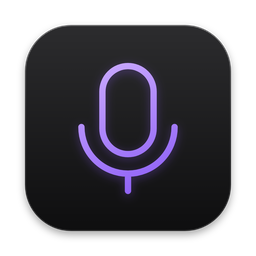
</p>

<p align="center"><b>Speak to type. Select to listen. Everything stays on your computer.</b></p>

<p align="center">Free, open-source voice tools for macOS, Windows and Linux.<br />Private, fast, and they work in every app, even offline.</p>

<p align="center">
  <a href="#download">Download</a> ·
  <a href="#how-to-use-glider">How to use</a> ·
  <a href="#build-it-yourself">Build it yourself</a> ·
  <a href="TROUBLESHOOT.md">Troubleshooting</a>
</p>

<br />

<p align="center">
  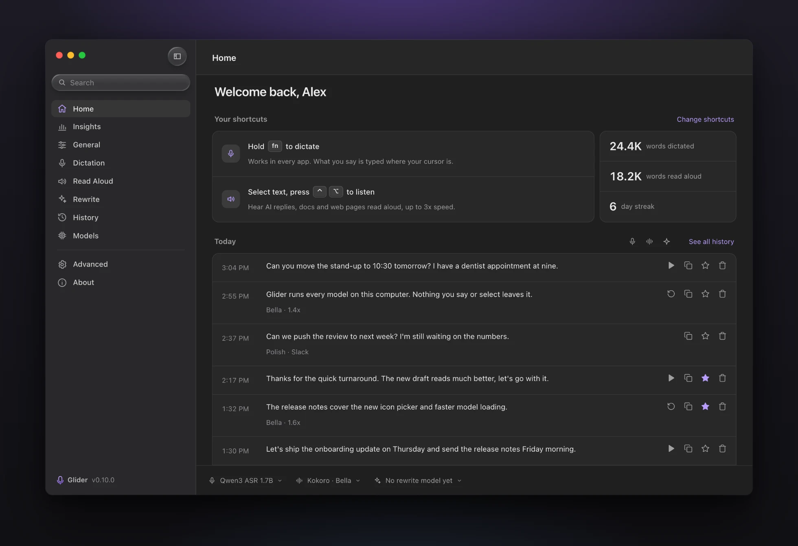
</p>

## Your voice never leaves your computer

Most voice apps send what you say to a server. Glider doesn't. Every model runs right on your machine, so not a single word you speak, select or rewrite gets uploaded anywhere.

- **Private by design.** No account, no cloud, no tracking. Your recordings and history live in a folder on your computer, and you can delete any of it.
- **Fast.** Models run on your own GPU (Metal on Mac, Vulkan on Windows and Linux), so your words land the moment you stop talking. No upload, no waiting on a server.
- **Works offline.** Once your models are downloaded, Glider doesn't need the internet. On a plane, on a train, anywhere.
- **Works wherever you type.** Your editor, browser, Slack, email, terminal or AI chat. If it takes text, Glider works there.
- **Free and open source.** MIT licensed, so you can read every line.

> Glider only goes online to download the models you pick and to check for updates, which you can turn off. If you choose to connect an online AI provider for Rewrite with your own API key, only the text you rewrite goes to that provider.

## What it does

**Dictation.** Hold a key and talk. Glider turns your speech into clean text and types it where your cursor is.

**Read Aloud.** Select any text and press a shortcut. A natural voice reads it to you, up to 3x speed. Great for long AI replies, docs and articles.

**Rewrite.** Select text and press a shortcut to polish it, turn it into a clear prompt, make it sound more human, or fix the grammar, right where it is.

**History and Insights.** Find anything you've said, replay past reads, and see how much time your voice saves you.

<table>
  <tr>
    <td width="50%">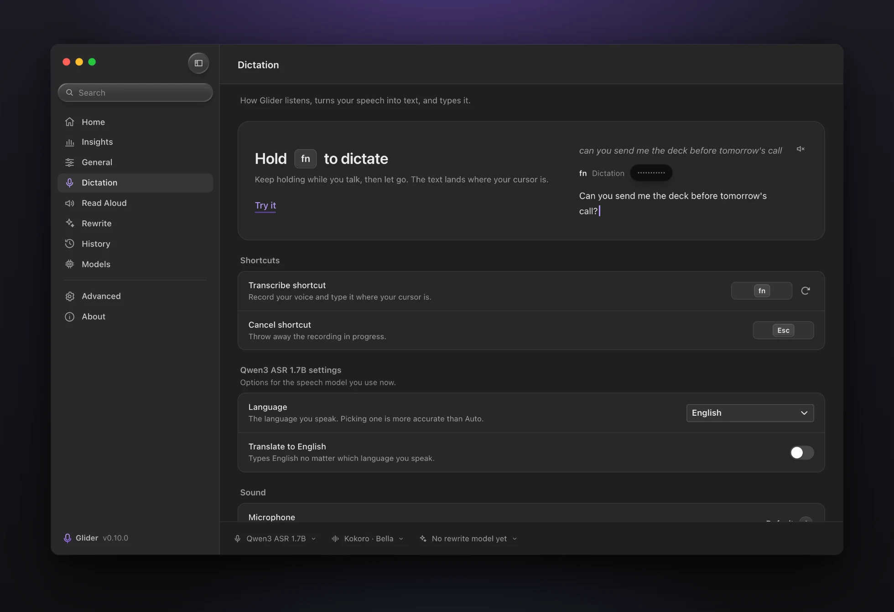<p align="center"><b>Dictation</b></p></td>
    <td width="50%">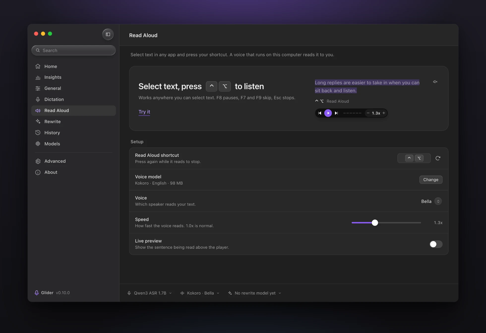<p align="center"><b>Read Aloud</b></p></td>
  </tr>
  <tr>
    <td width="50%">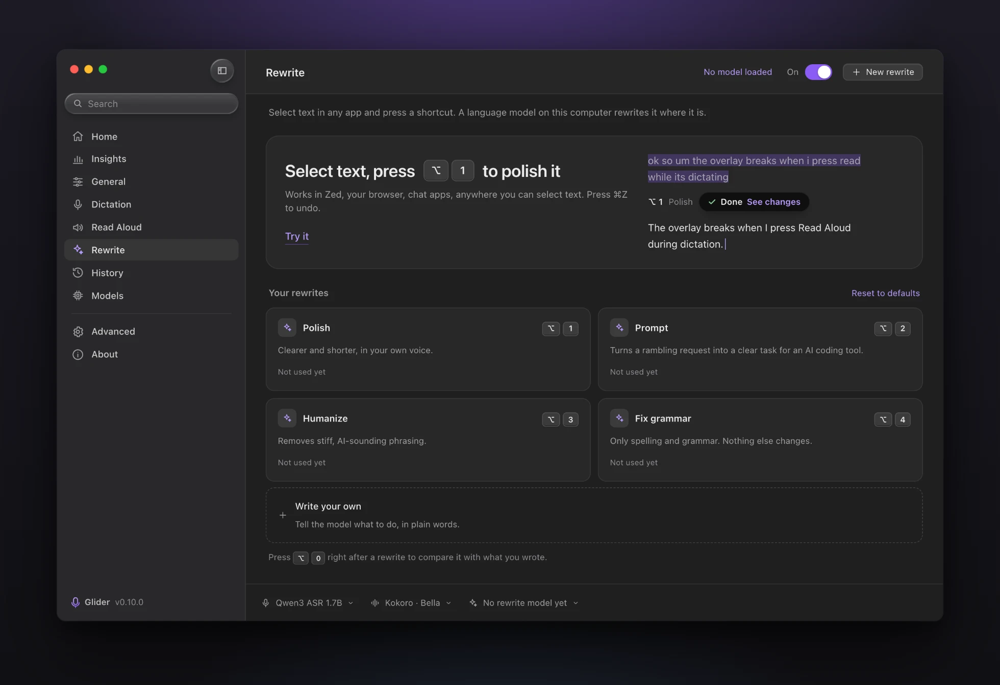<p align="center"><b>Rewrite</b></p></td>
    <td width="50%">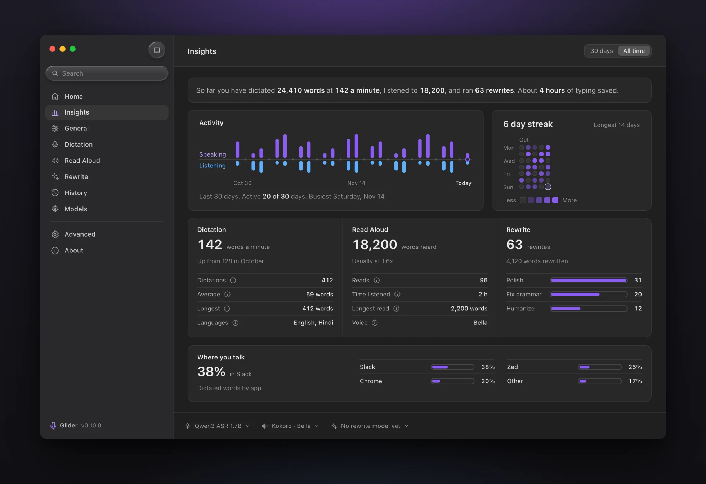<p align="center"><b>Insights</b></p></td>
  </tr>
</table>

## Download

Get Glider from the **[latest release](https://github.com/VivekGits7/Glider/releases/latest)**:

- **Windows:** `Glider_<version>_x64-setup.exe`
- **Mac with Apple silicon (M1 or newer):** `Glider_<version>_aarch64.dmg`
- **Intel Mac:** `Glider_<version>_x64.dmg`

After that, Glider offers new versions itself.

Glider isn't signed by Microsoft or Apple yet, so the first time you open it:

- **Windows:** if you see "Windows protected your PC", click **More info**, then **Run anyway**.
- **macOS:** if macOS can't verify Glider, open **System Settings → Privacy & Security**, scroll down and click **Open Anyway**.

On Linux, [build it yourself](BUILD.md).

## How to use Glider

### 1. Allow microphone and accessibility

Open Glider and allow both when setup asks. The microphone lets Glider hear you. Accessibility lets your shortcuts work in every app, so Glider can type where your cursor is and read the text you select.

<p align="center">
  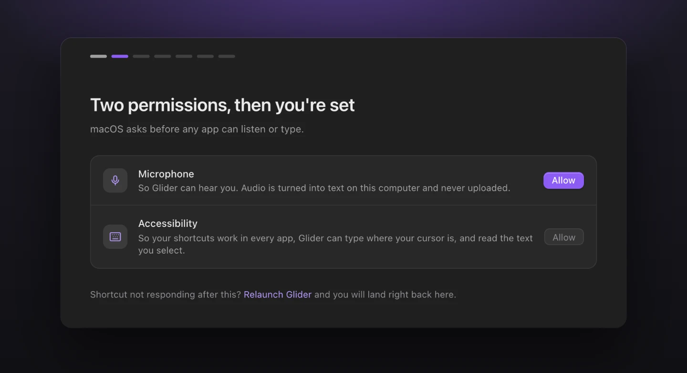
</p>

### 2. Pick your models

Setup offers models that fit your languages, one screen each for Dictation, Read Aloud and Rewrite. We recommend **Qwen3-ASR 1.7B** for Dictation, and **Kokoro** or **Supertonic 3** for Read Aloud. Rewrite is optional, so pick a model or skip it. Models download once, then run offline.

<table>
  <tr>
    <td width="33%">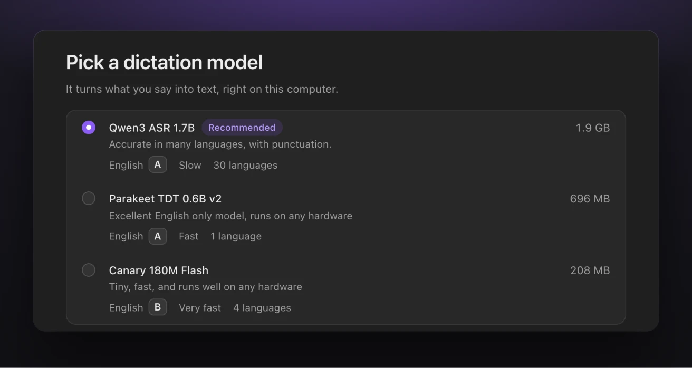<p align="center"><b>Dictation</b></p></td>
    <td width="33%">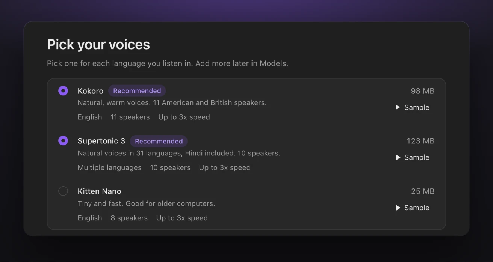<p align="center"><b>Read Aloud</b></p></td>
    <td width="33%">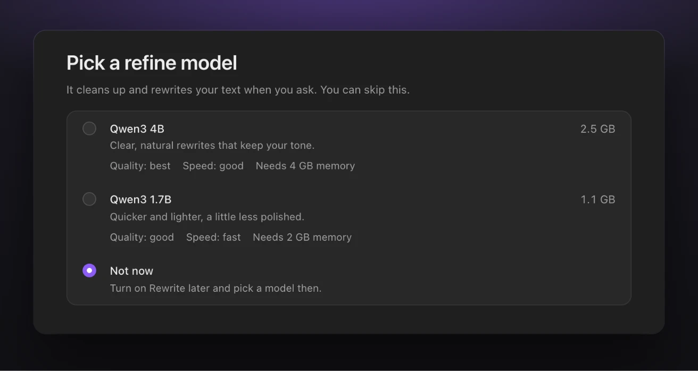<p align="center"><b>Rewrite</b></p></td>
  </tr>
</table>

### 3. Try it

The last setup step is a practice box. Click it, hold your dictation key and talk, and your words appear. Then select them and press the Read Aloud shortcut to hear them back. With a rewrite model, press `⌥ 1` on the same selection to polish it. You can come back to it any time with **Try it** on the Dictation page.

<p align="center">
  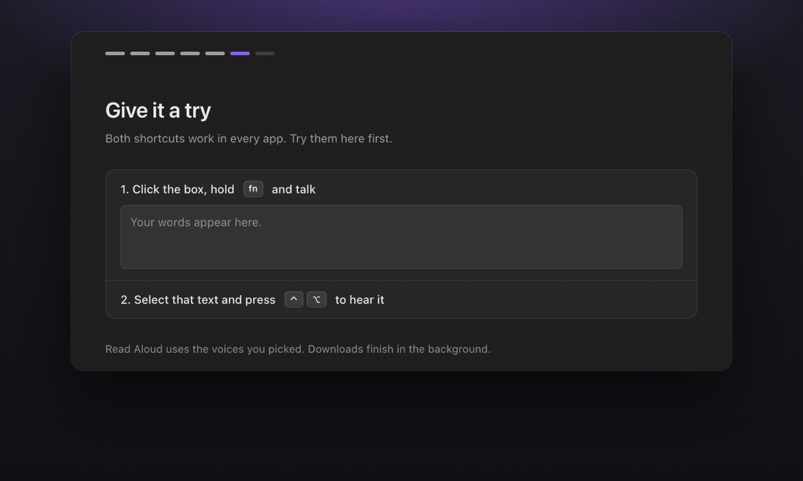
</p>

### 4. Use the shortcuts in any app

<table>
  <tr>
    <td width="33%">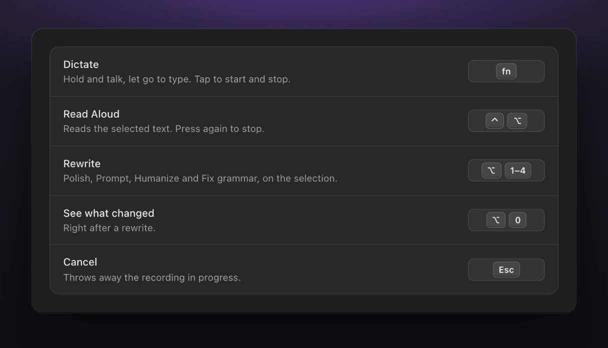<p align="center"><b>macOS</b></p></td>
    <td width="33%">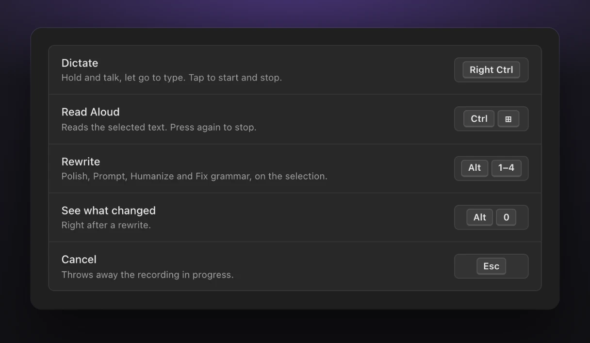<p align="center"><b>Windows</b></p></td>
    <td width="33%">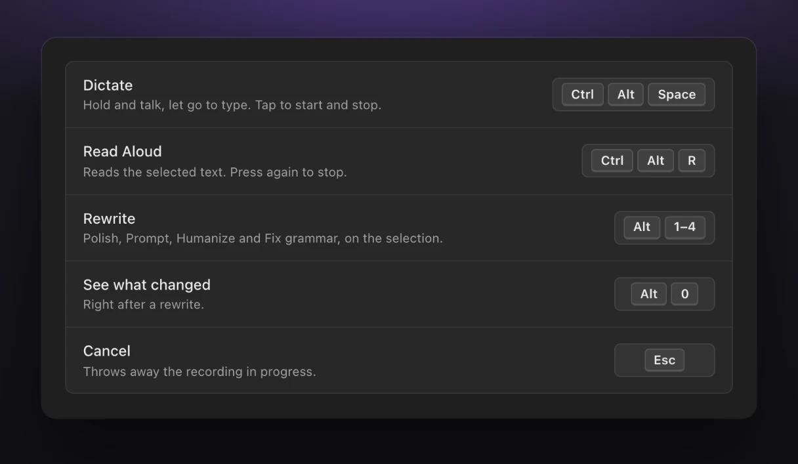<p align="center"><b>Linux</b></p></td>
  </tr>
</table>

Good to know:

- **Rewrite needs a language model.** Download one on the Models page, use Apple Intelligence on a supported Mac, or connect a provider with your own API key. Press `⌘ Z` (`Ctrl Z`) to undo a rewrite.
- **Control Read Aloud on macOS** with `F8` to pause, `F7` and `F9` to skip, and `Esc` to stop.
- **On macOS**, setup offers to set "Press 🌐 key to" to "Do Nothing", so holding `fn` doesn't also open the emoji picker.
- **Every shortcut can be changed** in Settings.

## Models

Every model runs on your computer, and Glider marks the ones we recommend. See [MODELS.md](MODELS.md) for the full list.

<table>
  <tr>
    <td width="50%">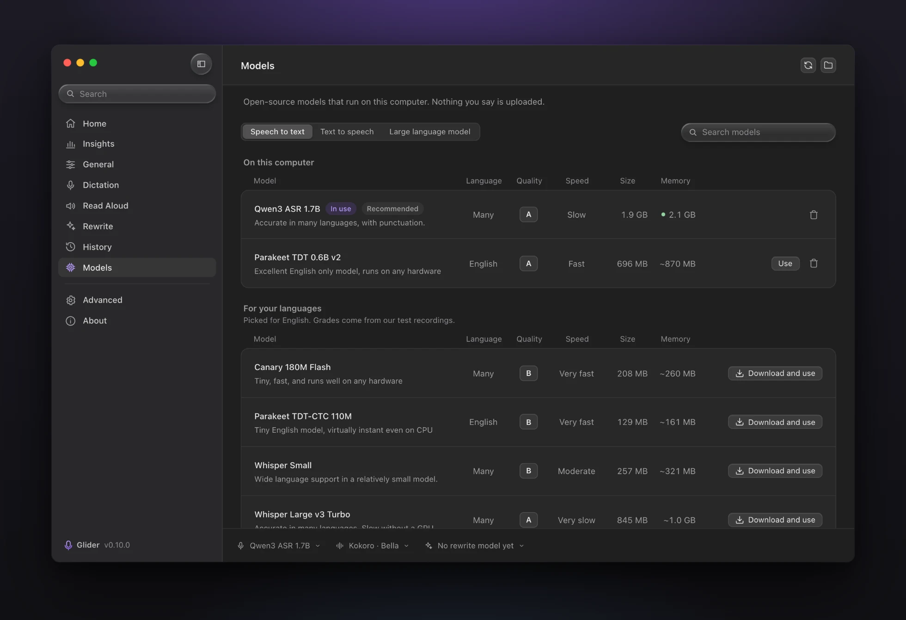<p align="center"><b>Dictation</b></p></td>
    <td width="50%">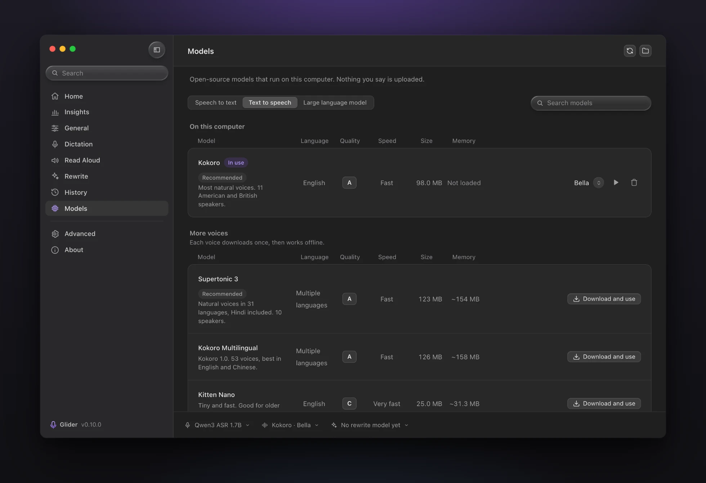<p align="center"><b>Read Aloud</b></p></td>
  </tr>
</table>

For Rewrite, download a local language model such as Qwen3, Gemma 3 or Llama 3.2, use Apple Intelligence on a supported Mac, or connect a provider with your own API key.

## Made for every desktop

The same app on macOS, Windows and Linux, with the look and feel of each system.

<p align="center">
  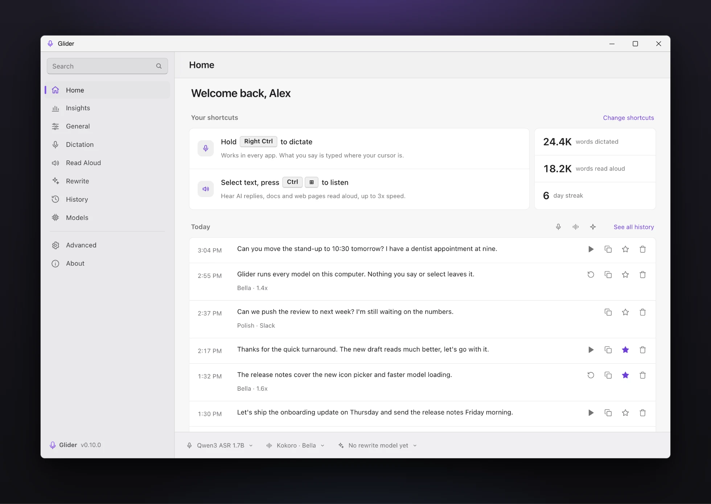
</p>

## Build it yourself

You need:

- **Rust** (latest stable): https://rustup.rs/
- **Bun**: https://bun.sh/
- **Tauri prerequisites**: https://tauri.app/start/prerequisites/

### macOS

```bash
# 1. Clone the repository
git clone https://github.com/VivekGits7/Glider.git
cd Glider

# 2. Install dependencies
bun install

# 3. Run it
bun tauri dev

# 4. Build the .dmg (lands in src-tauri/target/release/bundle/dmg/)
bun run tauri build
```

### Windows

Windows also needs CMake and the Vulkan SDK. Install them once, then open a new terminal:

```powershell
winget install Kitware.CMake
winget install KhronosGroup.VulkanSDK
```

```powershell
# 1. Clone the repository
git clone https://github.com/VivekGits7/Glider.git
cd Glider

# 2. Install dependencies
bun install

# 3. Run it
bun tauri dev

# 4. Build the installers (land in src-tauri\target\release\bundle\)
bun run tauri build
```

For Linux, see [BUILD.md](BUILD.md). If something goes wrong, see [TROUBLESHOOT.md](TROUBLESHOOT.md).

## For power users

### Command-line flags

Control a running Glider from scripts, window managers or your own hotkeys:

```bash
glider --toggle-transcription    # Start or stop recording
glider --toggle-post-process     # Start or stop recording with post-processing
glider --cancel                  # Cancel the current operation
```

Change how it starts:

```bash
glider --start-hidden            # Start without showing the window
glider --no-tray                 # Start without the tray icon
glider --help                    # Show every flag
```

On macOS, call the binary inside the app: `/Applications/Glider.app/Contents/MacOS/glider --toggle-transcription`.

## Contributing

- **Bugs:** open an [issue](https://github.com/VivekGits7/Glider/issues) with your OS, Glider version and steps to reproduce.
- **Ideas:** start a [discussion](https://github.com/VivekGits7/Glider/discussions) before writing code.
- **Pull requests:** run `bun run lint` and `bun run format` first, and test on the platform you changed.

## License

MIT, see [LICENSE](LICENSE). Glider's dictation is built on [Handy](https://github.com/cjpais/Handy) by CJ Pais, also MIT licensed.

## Acknowledgments

- **[Handy](https://github.com/cjpais/Handy)** by CJ Pais, which Glider's dictation is built on
- **Qwen3-ASR**, **Whisper**, **Parakeet** and the other open speech models
- **transcribe.cpp** and **ggml** for running models on your own computer
- **sherpa-onnx** with **Kokoro**, **Supertonic**, **Kitten** and **Piper** for the Read Aloud voices
- **Silero** for voice detection
- **Tauri** for the app framework
